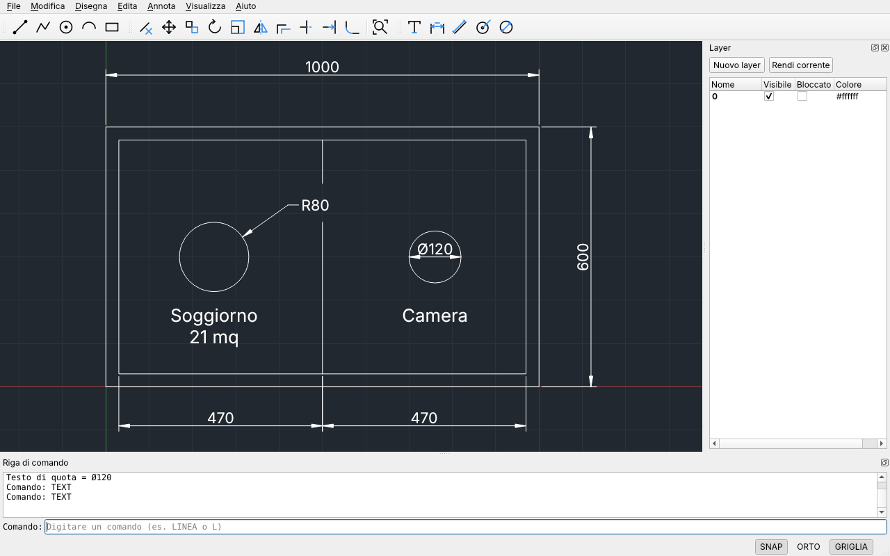
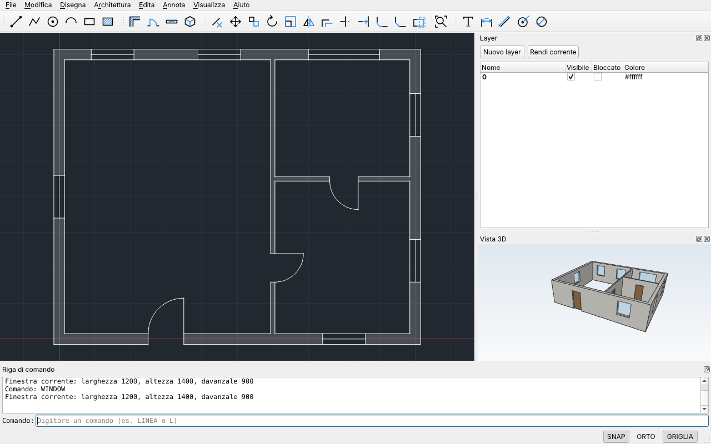
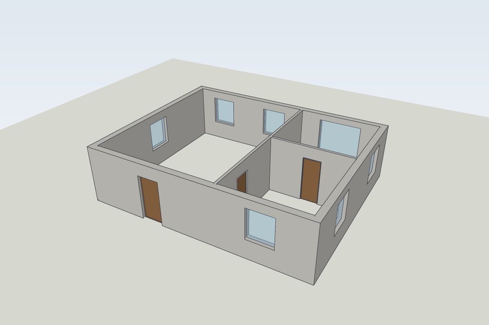
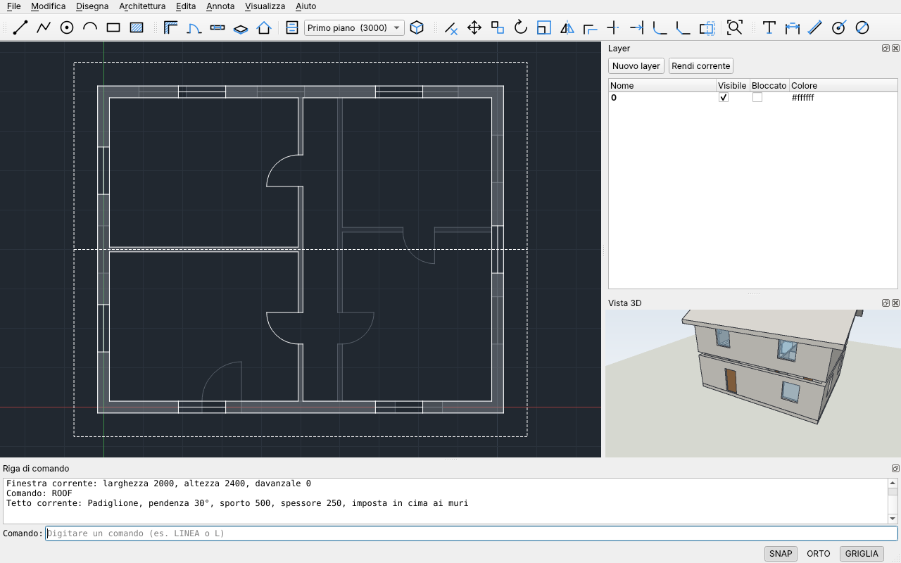
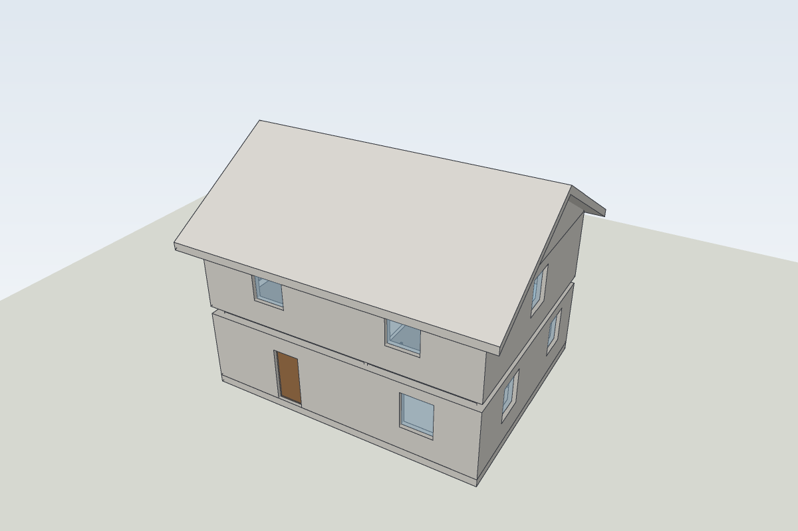
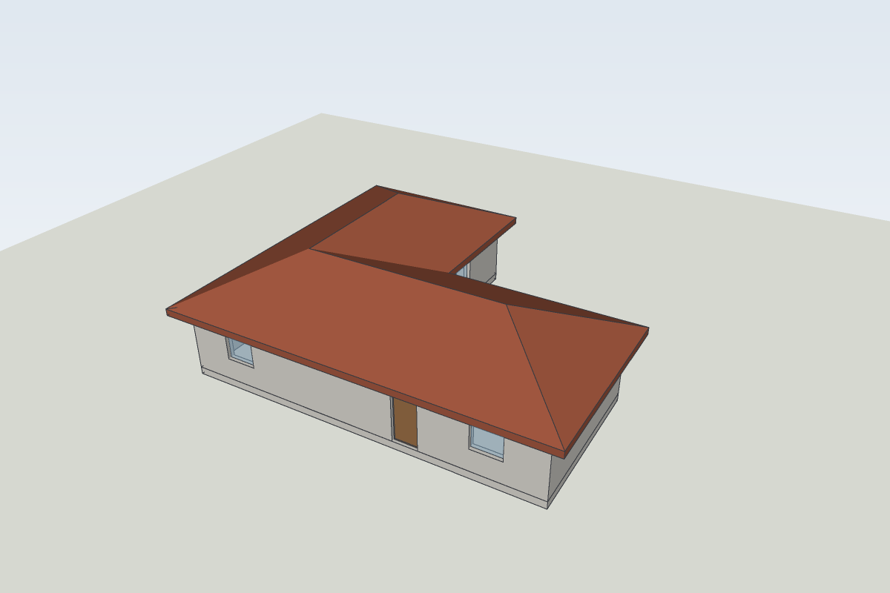
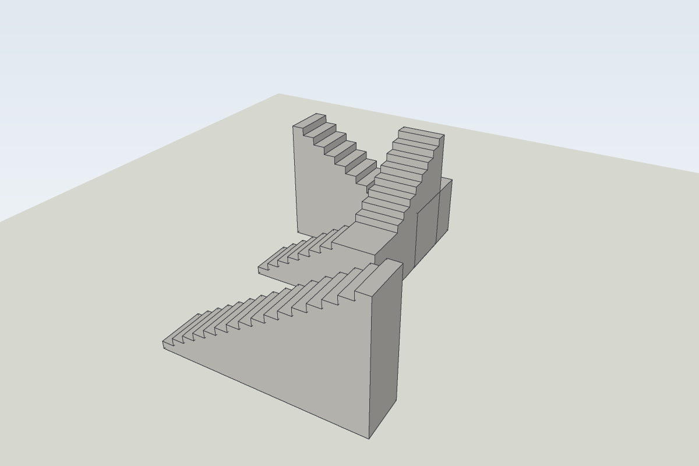
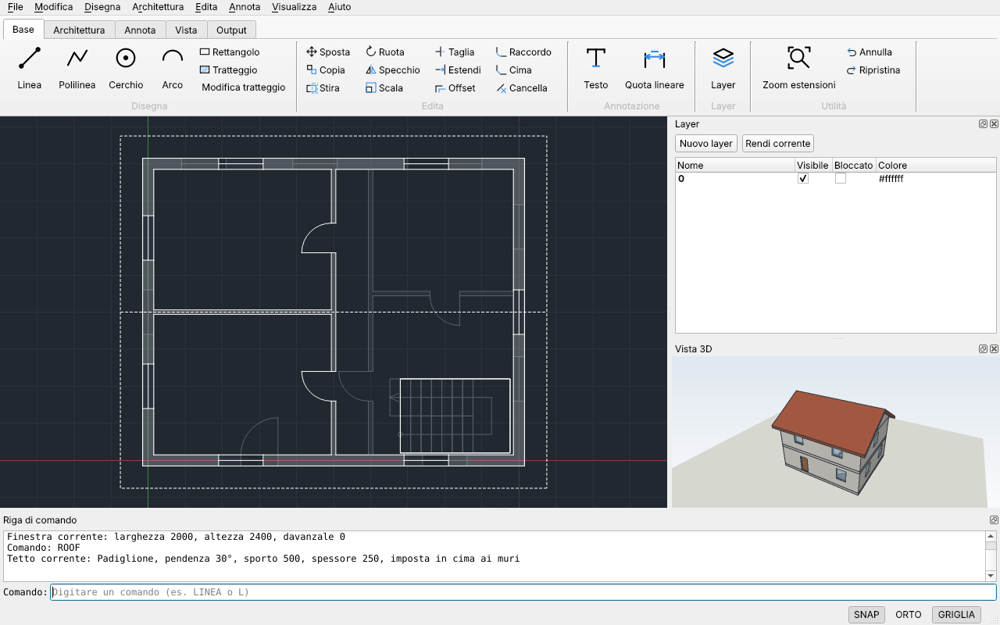
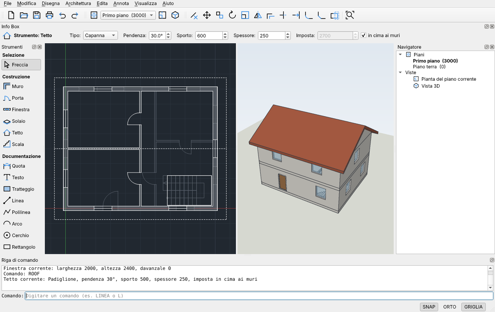
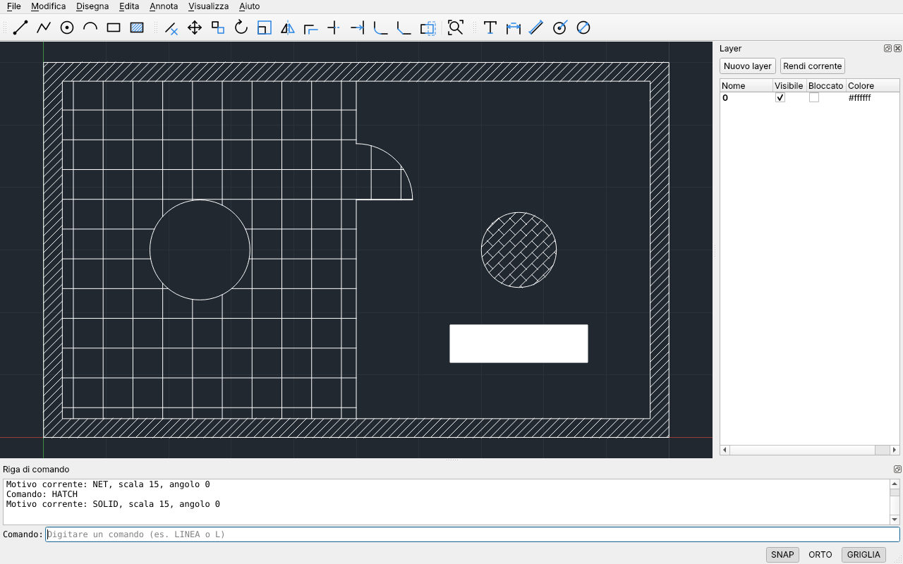

# CAD4All

CAD 2D e 3D parametrico per tecnici, open source. Il disegno 2D funziona come AutoCAD (comandi, alias, riga di comando, snap); il 3D parametrico è in stile ArchiCAD: si disegnano in pianta muri, porte e finestre e la vista 3D accanto si aggiorna mentre si disegna.


## Stato

Versione 0.1. Funziona già:

- **Disegno:** linea, polilinea con tratti dritti e archi, cerchio (raggio o diametro), arco per tre punti, rettangolo, tratteggio (contorno trovato cliccando un punto interno, con le isole, o scegliendo oggetti chiusi; 17 motivi ISO tra cui ANSI31, NET, BRICK, EARTH e il pieno SOLID).
- **Architettura:** muri con spessore, altezza e giustificazione (centro, sinistra, destra) che si uniscono da soli negli angoli a L, negli incroci a T e quando proseguono dritti; porte con lato e verso di apertura e finestre con davanzale, che forano il muro; solai cliccando dentro una stanza o sotto tutti i muri; piani dell'edificio con la loro quota; tetti a padiglione, a capanna, a una falda e piani, anche su piante a L, a T e a U; scale dritte, a L e a U; vista 3D con rotazione, spostamento e zoom.
- **Modifica:** cancella, sposta, copia (multipla), ruota, scala, specchio, offset (a distanza o per punto), taglia, estendi, raccordo tra linee, archi e cerchi (con raggio o a spigolo vivo), cima tra linee (due distanze o lunghezza e angolo), raccordo e cima su tutti gli angoli di una polilinea, stira con finestra interseca.
- **Annotazioni:** testo su una o più righe (allineato a sinistra, al centro o a destra, con rotazione), quote lineari (orizzontali, verticali, ruotate), allineate, di raggio e di diametro, con testo personalizzabile e scala delle quote.
- **Precisione:** coordinate assolute e relative (`10,20`, `@5,0`, `@10<45`), inserimento diretto della distanza, snap ad oggetto (fine, punto medio, centro, quadrante, intersezione, inserimento), orto.
- **Selezione:** clic, finestra (da sinistra a destra) e interseca (da destra a sinistra), Maiusc+clic per togliere.
- **Organizzazione:** layer con colore, visibilità e blocco.
- **Interfaccia:** ribbon come AutoCAD, oppure strumenti, Info Box e navigatore come ArchiCAD, con pianta e 3D in un pannello, affiancate o a schede.
- **File:** formato nativo `.c4a` (JSON leggibile), apertura dei DWG di AutoCAD, apertura e salvataggio DXF, stampa su stampante e in PDF in scala, esportazione del modello 3D in OBJ e STL, annulla e ripristina illimitati, script di comandi `.scr`.

In arrivo: installatori per Windows, macOS e Linux; tetti su piante con angoli diversi dal retto.

## Comandi

Si scrivono sulla riga di comando, in italiano, in inglese o con l'alias. Invio o Spazio confermano, Esc annulla, Invio a vuoto ripete l'ultimo comando. Il tasto destro del mouse vale come Invio.

| Comando | Alias | Opzioni |
| --- | --- | --- |
| LINEA / LINE | L | Annulla, Chiudi |
| PLINEA / PLINE | PL | Arco (archi tangenti), Linea, Chiudi, ANnulla |
| CERCHIO / CIRCLE | C | Diametro |
| ARCO / ARC | A | tre punti |
| RETTANGOLO / RECTANG | REC | |
| TRATTEGGIO / HATCH | H, BH | punto interno o Oggetti, Motivo (? per l'elenco), Scala, ANgolo; Invio crea il tratteggio |
| MODIFICATRATTEGGIO / HATCHEDIT | HE | Motivo, Scala, ANgolo di un tratteggio esistente |
| MURO / WALL | MU | Spessore, Altezza, Giustificazione (Centro/Sinistra/Destra), Chiudi, ANnulla; un muro per ogni tratto |
| PORTA / DOOR | PO | punto sul muro (centro della porta), poi lato di apertura; Larghezza, Altezza |
| FINESTRA / WINDOW | FI | punto sul muro (centro della finestra); Larghezza, Altezza, Davanzale |
| MODIFICAMURO / WALLEDIT | MM | Spessore, Altezza, Giustificazione di un muro, Elimina apertura |
| SOLAIO / SLAB | SO | punto dentro una stanza, Muri (sotto tutti i muri), Oggetti (polilinea chiusa o cerchio), Disegna, Foro (aggiunge un foro a un solaio), Spessore, Quota |
| TETTO / ROOF | TE | punti del contorno, Muri, Oggetti, Tipo (Padiglione/Capanna/Falda/PIano), Pendenza, Sporto, SPessore, Imposta |
| SCALINATA / STAIR | SN | punto iniziale e direzione; Tipo (Dritta/L/U), Verso (Sinistra/Destra), Larghezza, Altezza, Pedata |
| PIANO / STORY | PN | Nuovo, Corrente, Su, Giù, Rinomina, Quota, Altezza, Elimina, ? (elenco) |
| VISTA3D / VIEW3D | 3D | apre la vista 3D |
| CANCELLA / ERASE | E | (anche tasto Canc) |
| SPOSTA / MOVE | M | |
| COPIA / COPY | CO, CP | Esci |
| RUOTA / ROTATE | RO | angolo in gradi o punto |
| SCALA / SCALE | SC | fattore o punto |
| SPECCHIO / MIRROR | MI | Cancellare oggetti sorgente? Sì/No |
| OFFSET | O | distanza o Punto, Esci |
| TAGLIA / TRIM | TR | clic sulla parte da togliere, Esci |
| ESTENDI / EXTEND | EX | clic vicino all'estremità da allungare, Esci |
| RACCORDO / FILLET | F | Raggio (0 = spigolo vivo), Polilinea (tutti gli angoli); tra linee, archi e cerchi |
| CIMA / CHAMFER | CHA | Distanza, Angolo, Polilinea (tutti gli angoli) |
| STIRA / STRETCH | S | finestra interseca, poi punto base e secondo punto |
| TESTO / TEXT | DT | Giustifica (Sinistra/Centro/Destra); Spazio scrive uno spazio, Invio va a capo, Invio a vuoto termina |
| MODIFICATESTO / TEXTEDIT | ED | cambia un testo o il testo di una quota (`<>` = valore misurato) |
| QUOTALIN / DIMLINEAR | DLI | Invio per selezionare una linea; Testo, Orizzontale, Verticale, Ruotato |
| QUOTALLINEATA / DIMALIGNED | DAL | Invio per selezionare una linea; Testo |
| QUOTARAGGIO / DIMRADIUS | DRA | Testo |
| QUOTADIAMETRO / DIMDIAMETER | DDI | Testo |
| SCALAQUOTE / DIMSCALE | | moltiplica le dimensioni delle nuove quote (testo e frecce 2,5) |
| ZOOM | Z | Estensioni |
| LAYER | LA | apre il pannello layer |
| STAMPA / PLOT | | apre la finestra di stampa (anche Ctrl+P) |
| ANNULLA / UNDO | U | (anche Ctrl+Z) |
| RIPRISTINA / REDO | | (anche Ctrl+Y) |

Tasti: F3 snap ad oggetto, F7 griglia, F8 orto. Rotella per lo zoom, tasto centrale per spostare la vista, doppio clic del tasto centrale per lo zoom estensioni.

## Compilare

Servono CMake 3.28 o successivo, un compilatore C e C++20, Qt 6.4 o successivo e git. Alla prima configurazione CMake scarica e compila LibreDWG per la lettura dei DWG (un paio di minuti); per farne a meno: `-DCAD4ALL_WITH_DWG=OFF`.

```sh
cmake -S . -B build -DCMAKE_BUILD_TYPE=Release
cmake --build build --parallel
ctest --test-dir build --output-on-failure
./build/src/app/CAD4All
```

Su Ubuntu 24.04 le dipendenze si installano con `sudo apt install cmake ninja-build qt6-base-dev libgtest-dev`. Su Windows e macOS basta l'installer ufficiale di Qt. Ad ogni modifica GitHub Actions compila e prova il programma sui tre sistemi e conserva i pacchetti di Windows e macOS.

Per provare uno script: `CAD4All --script docs/esempi/pianta.scr` oppure `docs/esempi/modifica.scr` `docs/esempi/quote.scr`, `docs/esempi/cima-stira.scr`, `docs/esempi/polilinee.scr` e `docs/esempi/tratteggi.scr`.



## DWG e DXF

File > Apri legge i DWG di AutoCAD dalla versione R14 alla 2018 e successive grazie a [LibreDWG](https://www.gnu.org/software/libredwg/) (GPL 3), con gli stessi oggetti del DXF. Il DWG non viene mai sovrascritto: Salva chiede dove salvare il disegno in `.c4a` o `.dxf`.


File > Apri legge i DXF di qualsiasi versione salvati da AutoCAD o da altri CAD: linee, cerchi, archi, polilinee (anche con archi), testi e testi multilinea, quote, tratteggi (anche con motivi che CAD4All non ha), ellissi e spline (convertite in polilinee), solidi, direttrici e blocchi (esplosi, con i loro attributi), con i layer e i loro colori. Quello che non viene ancora letto (per esempio i solidi 3D) è elencato sulla riga di comando dopo l'apertura.

File > Salva con estensione `.dxf` o File > Esporta DXF scrivono un DXF R12, che si apre in ogni CAD; le quote restano quote, i tratteggi diventano blocchi di linee come in AutoCAD R12 (si vedono uguali ma non si modificano più come tratteggi). Da riga di comando: `CAD4All --script disegno.scr --export disegno.dxf`, oppure `CAD4All disegno.dwg --export disegno.dxf` per convertire un DWG.


## Muri, porte e finestre

MURO (alias MU) disegna una catena di muri come LINEA: ogni tratto è un muro. Spessore, altezza e giustificazione (dove passa la linea che si disegna: in asse, sulla faccia sinistra o sulla faccia destra) restano per i muri successivi. I muri che si toccano si uniscono da soli: a L negli angoli, a T quando un muro finisce contro un altro, e proseguono senza giunti se sono in linea. Le misure sono nell'unità del disegno: i valori iniziali (spessore 300, altezza 2700, porta 900 × 2100, finestra 1200 × 1400 con davanzale a 900) sono in millimetri.

PORTA e FINESTRA si mettono cliccando sul muro, nel punto che diventa il centro dell'apertura (lo snap al punto medio la centra nel muro). Per la porta un secondo clic indica dove apre: la parte del muro verso cui gira e lo stipite su cui è incernierata. MODIFICAMURO cambia un muro già disegnato o toglie una sua apertura; SPOSTA, RUOTA, SPECCHIO, SCALA e STIRA funzionano anche sui muri, con le loro porte e finestre.

La vista 3D si apre da sola con il primo muro (o con VISTA3D, o da Architettura > Vista 3D): si ruota trascinando, si sposta con il tasto destro o centrale, la rotella fa lo zoom e il doppio clic mostra tutto. Nel DXF i muri escono come le linee e gli archi della pianta. L'esempio [casa.scr](docs/esempi/casa.scr) disegna una piccola casa.





## Solai, piani, scale e tetti

Un edificio ha uno o più piani (PIANO, o il menu a tendina nella barra Architettura; Ctrl+PagSu e Ctrl+PagGiù passano al piano sopra o sotto). Ogni piano ha nome, quota e altezza; si disegna sempre sul piano corrente, la pianta mostra solo quello, con il piano sotto in grigio come riferimento, e la vista 3D mostra tutti i piani, ciascuno alla sua quota. Un piano nuovo va sopra il più alto e diventa corrente. Il DXF contiene il piano corrente.

SOLAIO crea un solaio cliccando dentro una stanza (le porte non la aprono), sotto tutti i muri del piano (Muri), lungo una polilinea chiusa o un cerchio (Oggetti) o disegnandone il contorno (Disegna). Lo spessore va verso il basso dalla quota superiore, che di solito coincide con il piano (Quota la sposta). Foro aggiunge a un solaio un foro lungo una polilinea chiusa o un cerchio, per esempio per la scala.

SCALINATA disegna una scala dal piano corrente a quello sopra: si clicca il centro del primo gradino e la direzione della prima rampa. Le alzate sono quante servono per non superare 18 cm, la pedata è di 28 cm se non indicata. La scala a L gira una volta e quella a U torna indietro, su un pianerottolo quadrato a metà altezza; Verso sceglie se girano a sinistra o a destra. In pianta si vedono i gradini e la linea di salita con la freccia.

TETTO crea un tetto sopra i muri del piano (Muri), su una polilinea chiusa o su un contorno disegnato punto per punto. Il tipo può essere a padiglione (falde su tutti i lati), a capanna (due falde sui lati lunghi, con i timpani chiusi da un muro), a una falda o piano; pendenza, sporto e spessore restano per i tetti successivi. Le falde partono dalla cima dei muri, a meno di un'altezza d'imposta data. Il contorno può essere convesso oppure fatto solo di angoli retti, come le piante a L, a T e a U: ogni ala ha il suo tetto e le ali si incontrano lungo i compluvi; nel tetto a capanna i timpani sono in fondo alle ali. In pianta il tetto si vede tratteggiato, con colmi, displuvi e compluvi.

L'esempio [casa-due-piani.scr](docs/esempi/casa-due-piani.scr) disegna una casa su due piani con solai, una scala a U e il tetto a capanna; [casa-a-l.scr](docs/esempi/casa-a-l.scr) una casa a L con il tetto a padiglione.









## Interfaccia come AutoCAD o come ArchiCAD

Visualizza > Interfaccia sceglie tra due disposizioni della finestra, ricordate alla riapertura:

- **Come AutoCAD:** ribbon con le schede Base, Architettura, Annota, Vista e Output, pannelli con i titoli e pulsanti grandi e piccoli; layer a destra e vista 3D in un pannello che si apre da solo con il primo muro.
- **Come ArchiCAD:** a sinistra la casella **Strumenti** (Freccia, Muro, Porta, Finestra, Solaio, Tetto, Scala, Quota, Testo, Tratteggio e gli oggetti 2D), con lo strumento in uso evidenziato; in alto l'**Info Box** con i parametri dello strumento (spessore e altezza del muro, tipo e pendenza del tetto, pedata della scala...) che si cambiano lì e valgono per i nuovi oggetti; a destra il **Navigatore** con i piani e le viste; pianta e 3D affiancate.

Selezionando un solo muro, solaio, tetto o scala l'Info Box mostra i suoi valori: cambiandoli l'oggetto si aggiorna in pianta e in 3D, con un solo passo di annullamento. Visualizza > Vista 3D mette il 3D in un pannello, affiancato alla pianta o in una scheda accanto. La riga di comando resta in entrambe. Da riga di comando: `--profilo autocad|archicad` e `--viste pannello|affiancate|schede`.





## Esportare il modello 3D

File > Esporta modello 3D salva l'edificio in OBJ (con i colori dei materiali in un file .mtl accanto, per Blender, SketchUp e i programmi di rendering) o in STL binario per la stampa 3D. Le misure sono quelle del disegno, di solito millimetri. Da riga di comando: `CAD4All --script casa.scr --export casa.obj`.

## Tratteggi

TRATTEGGIO (alias H) chiede un punto interno: il contorno chiuso più piccolo attorno al punto viene trovato da solo, anche se è fatto di linee separate che si incrociano, e gli oggetti chiusi al suo interno (un tavolo, un pilastro) restano vuoti. Si possono cliccare più zone, Invio crea il tratteggio. I motivi hanno le misure di AutoCAD in millimetri (`acadiso.pat`): per un disegno in centimetri o in metri la Scala va aumentata; se il motivo è troppo fitto CAD4All lo dice e suggerisce una scala.



## Stampa e PDF

File > Stampa (Ctrl+P, o il comando STAMPA) stampa su una stampante o salva un PDF: formato da A4 ad A0, orientamento, estensioni o vista corrente, scala adattata al foglio o 1:50, 1:100 e così via con l'unità del disegno, spessore delle linee e bianco e nero, con l'anteprima del foglio. Da riga di comando `--export disegno.pdf` salva un PDF A3 in bianco e nero adattato al foglio.

## Struttura

| Cartella | Contenuto |
| --- | --- |
| `src/core` | Geometria, entità e documento con annulla; C++ puro, senza Qt |
| `src/io` | Lettura e scrittura dei file (formato nativo, DXF, DWG con LibreDWG) |
| `src/engine` | Motore dei comandi e comandi stile AutoCAD (usa solo QtCore, si prova senza finestra) |
| `src/app` | Interfaccia Qt: vista di disegno, vista 3D, riga di comando, ribbon, strumenti, Info Box, navigatore, pannello layer, stampa |
| `tests` | Test automatici (GoogleTest) |

## Autore e licenza

Copyright © 2026 Gianluca Camerlengo, <g.camerlengo@gmail.com>.

CAD4All è software libero: puoi ridistribuirlo e modificarlo secondo i termini della GNU General Public License, versione 3 o successiva. Il testo completo è nel file [LICENSE](LICENSE) e nel programma, in Aiuto > Licenza.
